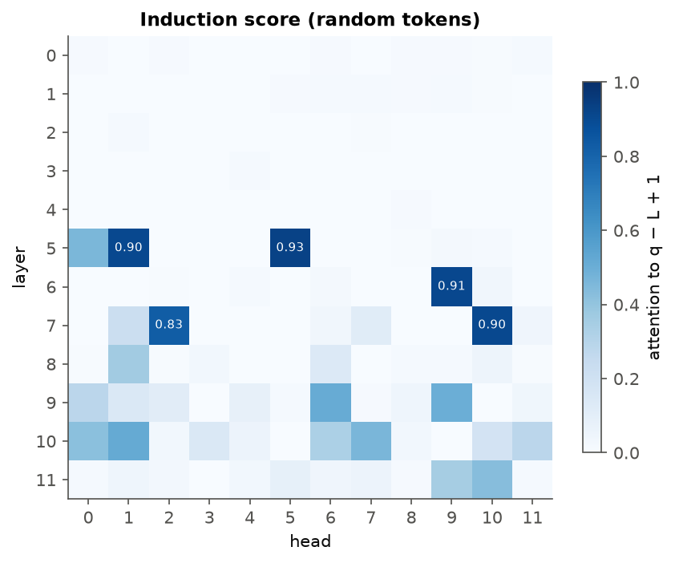
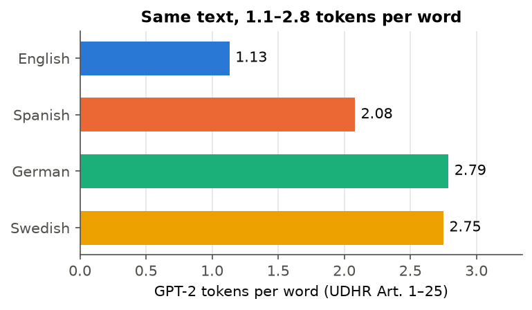
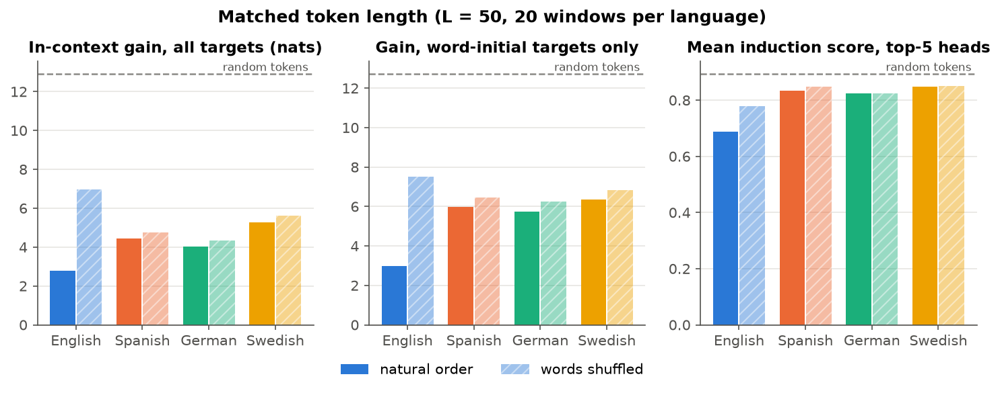

# Induction heads in GPT-2 small: a reproduction and a four-language check

A reproduction of the core result in Olsson, Elhage, Nanda et al. (2022),
[*In-context Learning and Induction Heads*](https://transformer-circuits.pub/2022/in-context-learning-and-induction-heads/index.html),
on GPT-2 small, extended to repeated text in **English, Spanish, German and Swedish**, with a control for
how differently GPT-2's tokenizer treats those languages.

**Summary**

- **Reproduced.** On repeated random tokens, loss falls from 13.2 to 0.28 nats on the second copy. The top
  induction heads are 5.5, 6.9, 5.1, 7.10 and 7.2, the same set ARENA reports.
- **Weaker ablation effect than expected.** Mean-ablating those five heads removes 41% of the in-context gain,
  not "most" of it. Removing most of it takes the top 10 heads (62%) or the top 20 (86%); five random heads remove 1%.
- **Same heads in all four languages.** At matched token length, each language's own top-5 heads are exactly
  the random-token top-5, and per-head induction scores correlate at Spearman ρ ≥ 0.96 across languages.
- **The tokenizer confound is large but didn't weaken Swedish.** GPT-2 uses 1.13 tokens per English word
  and 2.75 per Swedish word. Once sequences are matched in token length, Spanish, German and Swedish show
  similar induction scores (0.82–0.85). The language that stands out is **English, which scores lower**
  (0.69); this is only partly explained.
- **Naive "gain" comparisons mislead.** Differences in in-context gain between languages mostly reflect how
  well GPT-2 predicts each language *without* repetition, not how strongly induction operates.

Code: [`induction_heads.ipynb`](induction_heads.ipynb) (executed, with outputs) and [`induction.py`](induction.py).

---

## 1. The claim

> In GPT-2 small, a small set of attention heads attend from a token to the token that followed its previous
> occurrence; on repeated random token sequences these heads make the second repetition far easier to predict,
> and ablating them removes most of that advantage.

Setup: 20 sequences of 50 uniformly random tokens, each repeated once (`[BOS] x₁…x₅₀ x₁…x₅₀`).
**In-context gain** = mean loss on the first copy − mean loss on the second copy (49 predictions each).
**Induction score** of a head = mean attention from position *q* in the second copy to *q − 49*, the token
right after the earlier occurrence of the current token.

## 2. Reproduction results

| Metric | Paper / ARENA | This repo |
|---|---|---|
| Loss, first → second copy (random tokens) | large drop | 13.20 → 0.28 nats |
| Top induction heads | ~5.1, 5.5, 6.9, 7.2, 7.10 | 5.5 (0.93), 6.9 (0.91), 5.1 (0.90), 7.10 (0.90), 7.2 (0.83) |
| Gain removed by ablating them | most | **41%** (top 10: 62%, top 20: 86%) |
| Gain removed by 5 random heads | — | 0.8% (range 0.3–1.6% over 10 draws) |
| Top previous-token heads | layer ~4 | 4.11, 3.7, 6.8 |





**Ablation removes less than expected.** One head at a time, no single top-5 head removes more than 6% of the gain
(5.1 removes the most). All five together remove 41%. The gain keeps falling as heads further down the ranking
are added (10.1, 9.6, 9.9, 10.7 and 5.0 all score around 0.5). This fits redundant "backup" induction heads that
partly compensate when the main ones are removed. I used mean ablation (each head's output replaced by its average
over batch and position); zero ablation might give a different number, and I haven't tested it.

**K-composition check.** Mean-ablating the top three previous-token heads (4.11, 3.7, 6.8) roughly halves the
induction scores of the layer-5 heads (5.5: 0.93 → 0.49; 5.1: 0.90 → 0.45). Ablating three random heads from layers
0–4 leaves them unchanged. This is consistent with induction heads reading previous-token information through their
keys. Head 6.8 sits above layer 5, so the layer-5 effect must come from 4.11 and 3.7.

## 3. Extension: repeated natural text in four languages

**Question.** Do the same heads carry induction on real repeated text in English, Spanish, German and Swedish,
and with similar strength?

**Text.** Articles 1–25 of the Universal Declaration of Human Rights (NLTK `udhr` corpus): the same content in
all four languages.

### The tokenizer confound

GPT-2's BPE vocabulary was learned overwhelmingly from English. The same text fragments far more in the other
three languages (`Alla människor` → ` All|a| m|ä|nn|isk|or`):

| Language | Words | GPT-2 tokens | Tokens per word | Share of tokens that continue a word |
|---|---:|---:|---:|---:|
| English | 1030 | 1166 | **1.13** | 12% |
| Spanish | 1108 | 2306 | **2.08** | 52% |
| German | 967 | 2697 | **2.79** | 64% |
| Swedish | 951 | 2616 | **2.75** | 64% |



This matters in two ways. The same passage is 2–3× more tokens long outside English, and induction is measured
over a token distance. And many within-word continuation tokens are easy to predict even on first sight, so the
first copy already looks easier and the gain shrinks for reasons unrelated to induction. **If induction looked
weaker in Swedish, tokenization would be the first explanation to rule out, before any claim about how the model
represents Swedish.**

Three comparisons, from naive to controlled:

### 3a. Matched text (naive)

Each article repeated once, whatever its token length.

| Language | Mean tokens per article | First copy | Second copy | Gain | Top-5 induction score |
|---|---:|---:|---:|---:|---:|
| English | 47 | 2.81 | 0.20 | 2.61 | 0.67 |
| Spanish | 92 | 4.45 | 0.10 | 4.35 | 0.82 |
| German | 108 | 3.88 | 0.08 | 3.80 | 0.82 |
| Swedish | 105 | 5.28 | 0.11 | 5.17 | 0.83 |

Taken at face value, Swedish shows the biggest induction effect and English the smallest. But the second-copy loss is
near zero in every language. The gain differences come almost entirely from the **first** copy, meaning how well
GPT-2 predicts each language without any repetition, and the sequences differ by 2× in length. This table cannot
support a cross-language comparison.

### 3b. Matched token length (the control)

20 non-overlapping windows of exactly 50 tokens per language, each repeated once. At 50 tokens a window covers
about 44 English words but only about 18 Swedish ones; this is deliberate. Two further controls:

- **Word-initial targets only:** gain computed only where the predicted token starts a new word, which removes
  the easy within-word continuations.
- **Words shuffled:** the same words in random order. This removes grammar and any memorised UDHR text, so the
  first copy is hard in every language, closer to the random-token baseline.

| Language | Text | First copy | Second copy | Gain | Gain, word-initial | Top-5 induction | ρ vs random-token scores | Own top-5 = random top-5 | Gain removed, top-5 ablated | …5 random heads |
|---|---|---:|---:|---:|---:|---:|---:|---:|---:|---:|
| English | natural | 3.00 | 0.23 | 2.78 | 2.97 | **0.69** | 0.97 | 5/5 | 33% | 1% |
| | shuffled | 7.29 | 0.33 | 6.96 | 7.50 | 0.78 | 0.98 | 5/5 | 41% | 1% |
| Spanish | natural | 4.65 | 0.21 | 4.44 | 5.96 | 0.83 | 0.97 | 5/5 | 45% | 1% |
| | shuffled | 4.99 | 0.23 | 4.77 | 6.47 | 0.85 | 0.96 | 5/5 | 49% | 1% |
| German | natural | 4.24 | 0.21 | 4.03 | 5.74 | 0.82 | 0.96 | 5/5 | 50% | 1% |
| | shuffled | 4.59 | 0.26 | 4.34 | 6.25 | 0.82 | 0.96 | 5/5 | 52% | 2% |
| Swedish | natural | 5.49 | 0.20 | 5.29 | 6.35 | **0.85** | 0.97 | 5/5 | 44% | 1% |
| | shuffled | 5.84 | 0.24 | 5.60 | 6.83 | 0.85 | 0.98 | 5/5 | 40% | 0% |
| Random tokens | — | 13.20 | 0.28 | 12.93 | 12.74 | 0.89 | 1.00 | 5/5 | 41% | 1% |

Loss in nats. Full table: [`results/matched_length_L50.csv`](results/matched_length_L50.csv).




**What this shows**

1. **Same heads.** In every language and condition, the five heads with the highest induction score are exactly
   5.5, 6.9, 5.1, 7.10 and 7.2. Across all 144 heads, induction scores correlate at ρ = 0.96–0.98 with the
   random-token scores and at ρ ≥ 0.97 between languages.
2. **Same causal role.** Ablating those five heads removes 33–52% of the gain in every language, against 0–2% for
   five random heads, the same order as on random tokens (41%).
3. **Similar strength outside English.** Spanish, German and Swedish have top-5 induction scores of 0.82–0.85 at
   L = 50, and stay within 0.75–0.87 at L = 25, 50 and 100 ([`results/robustness_L.csv`](results/robustness_L.csv)).
   Swedish, the most fragmented, is not weaker.
4. **Gain tracks first-copy predictability, not induction.** Second-copy loss is 0.20–0.33 nats everywhere.
   Shuffling English raises its first-copy loss from 3.0 to 7.3 nats, presumably because GPT-2 knows English
   grammar and has likely seen the English UDHR. Shuffling barely changes the other three (+0.3–0.4 nats),
   which suggests GPT-2 makes little use of their word order to begin with.
5. **The within-word effect is real and language-dependent.** Restricting to word-initial targets raises the
   gain by 1.1–1.7 nats in Spanish, German and Swedish, against 0.2 in English. On all targets, the easy
   continuation tokens drag down the measured gain exactly in the languages the tokenizer fragments.

### 3c. Open question: why is English lower?

English has the lowest top-5 induction score (0.69 natural, 0.78 shuffled). One candidate: frequent English words
(*the*, *of*, *and*) occur several times per window, so several earlier positions are valid induction targets and
the strict score, which counts only *q − 49*, undercounts. The notebook (section 5e) checks this:

| | Second-copy tokens with >1 earlier occurrence | Strict score | Score counting any valid target |
|---|---:|---:|---:|
| English, natural | 44% | 0.69 | 0.73 |
| English, shuffled | 40% | 0.78 | 0.82 |
| Spanish / German / Swedish, natural | 22–32% | 0.82–0.85 | 0.86–0.88 |
| Random tokens | 0% | 0.89 | 0.89 |

Split attention accounts for a small part of the gap (+0.04), not most of it. Untested possibilities: when English
context is already predictable, other mechanisms (memorised text, n-gram statistics, other heads) may take over
part of the work; or the effect may be specific to this text. I'm leaving it open rather than guessing.

## 4. Caveats

- **One text, one register.** All natural-text results come from the UDHR: formal legal language, probably in
  GPT-2's training data, at least in English. Other genres could behave differently.
- **Small samples.** 20 windows of 50 tokens per language (English has only 23 available). Apart from the
  random-head draws there are no confidence intervals, so differences of a few hundredths in induction score
  should be read as noise.
- **Matched length means unmatched content.** A 50-token Swedish window contains less than half as many words as
  an English one, and the translations are not sentence-aligned. The NLTK Swedish version is an older translation
  (*äro* for *är*).
- **Heads chosen on random tokens.** The top-5 set is fixed from the random-token run and reused for every language,
  which is the right test for "are the same heads responsible?" but could miss language-specific helpers further
  down the ranking.
- **Mean ablation only**, computed on the same batch it is applied to.

## 5. Reproduce

```bash
uv venv ~/research-env --python 3.12
uv pip install --python ~/research-env/bin/python -r requirements.txt
~/research-env/bin/jupyter nbconvert --to notebook --execute --inplace induction_heads.ipynb
```

Runs on a laptop CPU in about 10 minutes. Note: TransformerLens 4.0 removed the `HookedTransformer` API used here
(and in ARENA), so `requirements.txt` pins `transformer_lens<4`.

| File | Contents |
|---|---|
| `induction_heads.ipynb` | Full analysis with outputs |
| `induction.py` | Helpers: inputs, losses, induction / previous-token scores, ablation |
| `figures/` | All plots |
| `results/` | `summary.json`, matched-length and robustness tables |

## Acknowledgements

Follows the structure of ARENA chapter 1.2, *Intro to Mechanistic Interpretability*. Built on
[TransformerLens](https://github.com/TransformerLensOrg/TransformerLens). Code written with assistance from Claude
(Anthropic).
