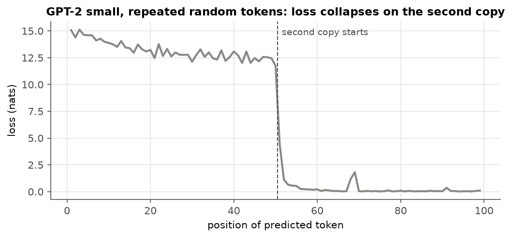
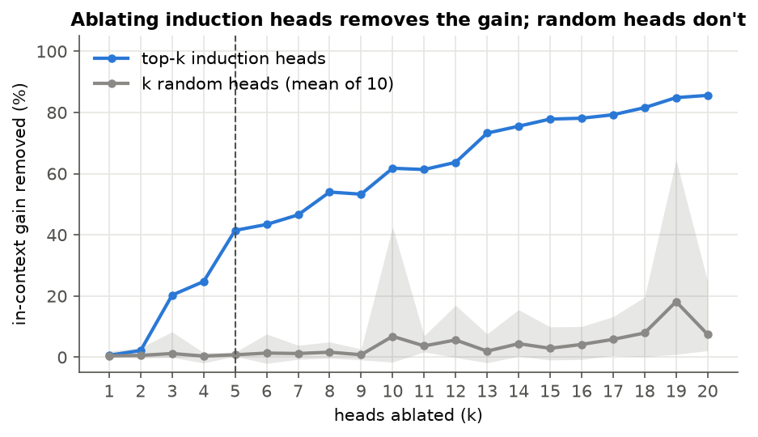
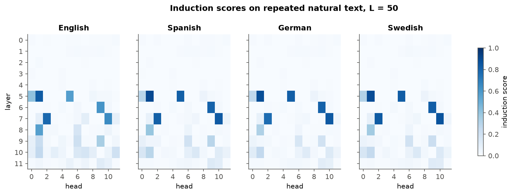
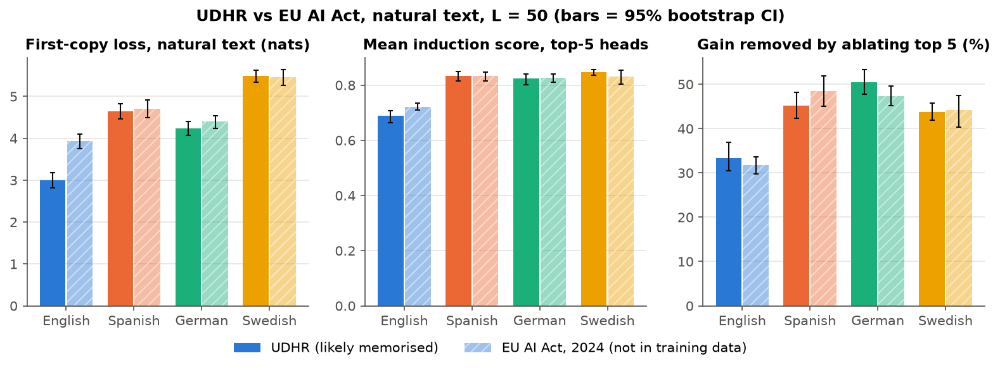

# Induction heads in GPT-2 small: a reproduction and a four-language check

A reproduction of the core result in Olsson, Elhage, Nanda et al. (2022),
[*In-context Learning and Induction Heads*](https://transformer-circuits.pub/2022/in-context-learning-and-induction-heads/index.html),
on GPT-2 small, extended to repeated text in **English, Spanish, German and Swedish**, with a control for
how differently GPT-2's tokenizer treats those languages.

**Summary**

- **Reproduced.** On repeated random tokens, loss falls from 13.2 to 0.28 nats on the second copy. The top
  induction heads are 5.5, 6.9, 5.1, 7.10 and 7.2, the same set ARENA reports.
- **Weaker ablation effect than expected.** Mean-ablating those five heads removes 41% [39, 44] of the in-context
  gain, not "most" of it. Removing most of it takes the top 10 heads (62%) or the top 20 (86%); zero ablation of
  the top 20 removes 98%. Five random heads remove about 1%.
- **Same heads in all four languages.** At matched token length, each language's own top-5 heads are exactly
  the random-token top-5, on both texts tested, and per-head induction scores correlate at Spearman ρ ≥ 0.96.
- **The tokenizer confound is large but didn't weaken Swedish.** GPT-2 uses about 1.1 tokens per English word
  and 2.8–3.1 per German or Swedish word. Once sequences are matched in token length, Spanish, German and Swedish
  show similar induction scores (0.82–0.86). The language that stands out is **English, which scores lower**
  (0.69 on the UDHR, 0.72 on the EU AI Act).
- **The English gap is not explained by memorisation.** It persists on the EU AI Act (2024), which GPT-2 cannot
  have seen. Split attention over repeated words doesn't explain it either; the cause is still open.
- **Naive "gain" comparisons mislead.** Differences in in-context gain between languages mostly reflect how
  well GPT-2 predicts each language *without* repetition, not how strongly induction operates.

Numbers in brackets are 95% bootstrap confidence intervals (see [Uncertainty](#uncertainty)).
Code: [`induction_heads.ipynb`](induction_heads.ipynb) (executed, with outputs) and [`induction.py`](induction.py).

---

## What changed in this revision (November 2026)

This version adds held-out mean ablation, zero ablation, bootstrap confidence intervals and a second text
(the EU AI Act). Findings that changed, and are marked **[revised]** where they appear below:

1. **Ablation method.** Mean ablation previously averaged each head's output over the same batch it was applied to.
   The averages now come from held-out data. This barely moved anything: the language rows changed by at most
   0.15 points and the random-token row by 0.24 (41.45% → 41.21%). Every value rounds to the same whole percent.
2. **"Same causal role" was too strong.** The previous version said ablating the top 5 heads removes 33–52% of the
   gain "in every language … the same order as on random tokens". With confidence intervals, the share differs
   between languages beyond sampling noise: English is lowest on both texts (33% [31, 37] on the UDHR, against
   44–50% for the other three). The same heads matter everywhere; how much of the gain they carry does not match.
3. **The random-head control is about 1% only at k = 5.** At larger k, single random draws sometimes remove a
   lot (up to 64% at k = 19), so the control is not flat across k.
4. **The English shuffle effect is not about memorisation.** The previous version attributed the jump in English
   first-copy loss under word shuffling partly to GPT-2 having seen the UDHR. The same jump appears on the AI Act,
   so it reflects GPT-2's knowledge of English, not a memorised text.
5. **Split attention explains essentially none of the English gap.** The previous version said counting attention
   to any valid induction target "accounts for a small part of the gap (+0.04)". That compared English before and
   after, but the other languages rise by as much. Measured as a gap, it closes about 0.01 on the UDHR and none on
   the AI Act.
6. **Zero ablation**, previously listed as untested, is now reported.

---

## 1. The claim

> In GPT-2 small, a small set of attention heads attend from a token to the token that followed its previous
> occurrence; on repeated random token sequences these heads make the second repetition far easier to predict,
> and ablating them removes most of that advantage.

Setup: 20 sequences of 50 uniformly random tokens, each repeated once (`[BOS] x₁…x₅₀ x₁…x₅₀`).
**In-context gain** = mean loss on the first copy − mean loss on the second copy (49 predictions each).
**Induction score** of a head = mean attention from position *q* in the second copy to *q − 49*, the token
right after the earlier occurrence of the current token.

## 2. Reproduction results

| Metric | Paper / ARENA | This repo |
|---|---|---|
| Loss, first → second copy (random tokens) | large drop | 13.20 → 0.28 nats (gain 12.93 [12.82, 13.04]) |
| Top induction heads | ~5.1, 5.5, 6.9, 7.2, 7.10 | 5.5 (0.93), 6.9 (0.91), 5.1 (0.90), 7.10 (0.90), 7.2 (0.83); mean 0.89 [0.89, 0.90] |
| Gain removed by mean-ablating them | most | **41.2% [38.8, 43.6]** (top 10: 61.8% [59.6, 64.1]; top 20: 85.7% [84.4, 87.2]) |
| Same, zero ablation | — | 30.6% [27.6, 33.4] (top 10: 69.3% [65.7, 72.8]; top 20: 98.3% [95.2, 101.2]) |
| Gain removed by 5 random heads | — | mean ablation 0.8% (range 0.3–1.6 over 10 draws); zero ablation −2.1% (range −21.8 to 2.1) |
| Top previous-token heads | layer ~4 | 4.11, 3.7, 6.8 |






**How the ablations work.** *Mean ablation* replaces a head's output with its average output (over batch and
position) on a **held-out** batch of random tokens with a different seed, never the batch being evaluated.
**[revised]** The previous version computed the average on the evaluated batch itself; switching to held-out
averages changed the top-5 result from 41.4% to 41.2%. *Zero ablation* sets the head's output to zero, which
also removes the head's constant contribution and puts the model in states it never sees in training.

**Ablation removes less than expected.** One head at a time, no single top-5 head removes more than 6% of the gain
(5.1 removes the most, 5.7%). All five together remove 41%. The gain keeps falling as heads further down the
ranking are added (10.1, 9.6, 9.9, 10.7 and 5.0 all score around 0.5). This fits redundant "backup" induction heads
that partly compensate when the main ones are removed.

**Mean vs zero ablation.** The two diverge in both directions. With few heads, zero ablation removes *less*
(31% vs 41% at k = 5); with many it removes more, and zero-ablating the top 20 removes essentially all of the gain
(98%; the interval reaches past 100% because on some resamples the second copy becomes slightly harder than the first).
Zero ablation is also noisier: zeroing random heads sometimes *increases* the gain (one draw of 5 heads: −22%).
I treat mean ablation as the main measure and zero ablation as a bound.

**The random-head control depends on k.** **[revised]** At k = 5, random heads remove about 1%. At larger k it is
not flat: averaged over 10 draws, 19 random heads remove 18.0% (mean ablation) or 12.9% (zero), and 20 remove
7.5% or 17.0%. Single draws reach 64%, presumably when a random set picks up strong heads ranked just outside the
top 20 (the control excludes only the top 20). The top-k curve stays well above the random average at every k.

**K-composition check.** Mean-ablating the top three previous-token heads (4.11, 3.7, 6.8) roughly halves the
induction scores of the layer-5 heads (5.5: 0.93 → 0.49; 5.1: 0.90 → 0.45). Ablating three random heads from layers
0–4 leaves them unchanged. This is consistent with induction heads reading previous-token information through their
keys. Head 6.8 sits above layer 5, so the layer-5 effect must come from 4.11 and 3.7.

## 3. Extension: repeated natural text in four languages

**Question.** Do the same heads carry induction on real repeated text in English, Spanish, German and Swedish,
and with similar strength?

**Texts.**
- **UDHR:** Articles 1–25 of the Universal Declaration of Human Rights (NLTK `udhr` corpus), the same content in
  all four languages. Old and widely reproduced, so GPT-2 has very likely seen it, at least in English.
- **EU AI Act:** Recitals 1–180 of Regulation (EU) 2024/1689, official language versions
  ([`data/ai_act/`](data/ai_act/SOURCE.md)). Adopted in 2024, after GPT-2's training data was collected, so it
  cannot be memorised. Section 3d.

### The tokenizer confound

GPT-2's BPE vocabulary was learned overwhelmingly from English. The same text fragments far more in the other
three languages (`Alla människor` → ` All|a| m|ä|nn|isk|or`):

| Language | UDHR tokens per word | AI Act tokens per word | Share of UDHR tokens that continue a word |
|---|---:|---:|---:|
| English | **1.13** | **1.16** | 12% |
| Spanish | **2.08** | **2.05** | 52% |
| German | **2.79** | **3.05** | 64% |
| Swedish | **2.75** | **2.90** | 64% |


This matters in two ways. The same passage is 2–3× more tokens long outside English, and induction is measured
over a token distance. And many within-word continuation tokens are easy to predict even on first sight, so the
first copy already looks easier and the gain shrinks for reasons unrelated to induction. **If induction looked
weaker in Swedish, tokenization would be the first explanation to rule out, before any claim about how the model
represents Swedish.**

Three comparisons, from naive to controlled, then the second text:

### 3a. Matched text (naive)

Each UDHR article repeated once, whatever its token length. Intervals resample the 25 articles.

| Language | Mean tokens per article | First copy | Second copy | Gain | Top-5 induction score |
|---|---:|---:|---:|---:|---:|
| English | 47 | 2.81 | 0.20 | 2.61 [2.38, 2.83] | 0.67 [0.64, 0.69] |
| Spanish | 92 | 4.45 | 0.10 | 4.35 [4.10, 4.65] | 0.82 [0.81, 0.84] |
| German | 108 | 3.88 | 0.08 | 3.80 [3.68, 3.96] | 0.82 [0.80, 0.83] |
| Swedish | 105 | 5.28 | 0.11 | 5.17 [4.95, 5.40] | 0.83 [0.82, 0.85] |

Taken at face value, Swedish shows the biggest induction effect and English the smallest. But the second-copy loss is
near zero in every language. The gain differences come almost entirely from the **first** copy, meaning how well
GPT-2 predicts each language without any repetition, and the sequences differ by 2× in length. This table cannot
support a cross-language comparison.

### 3b. Matched token length (the control)

20 non-overlapping windows of exactly 50 tokens per language, each repeated once. At 50 tokens a window covers
about 44 English words but only about 18 Swedish ones; this is deliberate. Two further controls:

- **Word-initial targets only:** gain computed only where the predicted token starts a new word, which removes
  the easy within-word continuations.
- **Words shuffled:** the same words in random order. This removes grammar and any memorised text, so the
  first copy is hard in every language, closer to the random-token baseline.

Mean ablation here uses **two-fold cross-fitting**: the UDHR is too short to hold out separate English windows
(23 exist), so the 20 windows are split into interleaved halves and each half is ablated with averages computed
on the other half.

UDHR, L = 50 (loss in nats):

| Language | Text | First copy | Gain | Gain, word-initial | Top-5 induction | Gain removed, top-5 ablated | …5 random heads |
|---|---|---:|---:|---:|---:|---:|---:|
| English | natural | 3.00 | 2.78 [2.60, 2.95] | 2.97 [2.77, 3.15] | **0.69 [0.66, 0.71]** | **33.3% [30.5, 36.9]** | 0.9% |
| | shuffled | 7.29 | 6.96 [6.83, 7.11] | 7.50 [7.31, 7.68] | 0.78 [0.77, 0.79] | 41.2% [38.8, 43.6] | 1.3% |
| Spanish | natural | 4.65 | 4.44 [4.26, 4.60] | 5.96 [5.77, 6.18] | 0.83 [0.82, 0.85] | 45.2% [42.4, 48.1] | 0.8% |
| | shuffled | 4.99 | 4.77 [4.61, 4.93] | 6.47 [6.29, 6.65] | 0.85 [0.84, 0.86] | 48.8% [46.9, 50.4] | 1.2% |
| German | natural | 4.24 | 4.03 [3.86, 4.20] | 5.74 [5.46, 6.02] | 0.82 [0.80, 0.84] | 50.4% [47.7, 53.4] | 0.6% |
| | shuffled | 4.59 | 4.34 [4.15, 4.53] | 6.25 [6.03, 6.50] | 0.82 [0.81, 0.84] | 52.3% [49.8, 54.8] | 2.5% |
| Swedish | natural | 5.49 | 5.29 [5.14, 5.42] | 6.35 [6.12, 6.57] | **0.85 [0.84, 0.86]** | 43.8% [41.8, 45.8] | 1.0% |
| | shuffled | 5.84 | 5.60 [5.36, 5.85] | 6.83 [6.43, 7.18] | 0.85 [0.84, 0.86] | 40.0% [37.9, 42.1] | 0.4% |
| Random tokens | — | 13.20 | 12.93 [12.82, 13.04] | 12.74 [12.55, 12.91] | 0.89 [0.89, 0.90] | 41.2% [38.8, 43.6] | 0.8% |

Second-copy loss is 0.20–0.33 nats in every row. Full table: [`results/matched_length_L50.csv`](results/matched_length_L50.csv).




**What this shows**

1. **Same heads.** In every language and condition, the five heads with the highest induction score are exactly
   5.5, 6.9, 5.1, 7.10 and 7.2. Across all 144 heads, induction scores correlate at ρ = 0.96–0.98 with the
   random-token scores and at ρ ≥ 0.97 between languages.
2. **The same heads matter causally, but not equally.** **[revised]** Ablating those five heads removes 33–52% of the
   gain in every language and condition, against 0.4–2.5% for five random heads. But the share differs between
   languages beyond sampling noise: English natural text 33% [31, 37] against German 50% [48, 53] and Spanish 45%
   [42, 48]. The previous version described these as the same order; the intervals don't support that.
3. **Similar induction strength outside English.** Spanish, German and Swedish have top-5 induction scores of 0.82–0.85
   at L = 50, and stay within 0.75–0.87 at L = 25, 50 and 100 ([`results/robustness_L.csv`](results/robustness_L.csv)).
   Swedish, the most fragmented, is not weaker. English is lower, and its interval does not overlap theirs.
4. **Gain tracks first-copy predictability, not induction.** Second-copy loss is 0.20–0.33 nats everywhere.
   Shuffling English raises its first-copy loss from 3.0 to 7.3 nats; shuffling barely changes the other three
   (+0.3–0.4 nats), which suggests GPT-2 makes little use of their word order. **[revised]** The previous version
   attributed the English jump partly to GPT-2 having seen the English UDHR; the AI Act (3d) shows the same jump on
   unmemorised text, so it reflects GPT-2's knowledge of English.
5. **The within-word effect is real and language-dependent.** Restricting to word-initial targets raises the
   gain by 1.1–1.7 nats in Spanish, German and Swedish (natural text), against 0.2 in English. On all targets, the
   easy continuation tokens drag down the measured gain exactly in the languages the tokenizer fragments.

### 3c. Open question: why is English lower?

English has the lowest top-5 induction score on both texts (UDHR 0.69, AI Act 0.72, against 0.82–0.85 for the
others), and ablating the top heads removes the smallest share of its gain. Two explanations have been checked.

**Split attention: essentially none of it.** **[revised]** Frequent English words (*the*, *of*, *and*) occur several times per window, so
several earlier positions are valid induction targets and the strict score, which counts only *q − 49*,
undercounts. Counting attention to *any* valid target:

| | Second-copy tokens with >1 earlier occurrence | Strict score | Score counting any valid target |
|---|---:|---:|---:|
| English, UDHR natural | 44% | 0.69 | 0.73 |
| English, AI Act natural | 35% | 0.72 | 0.75 |
| Spanish / German / Swedish, both texts, natural | 22–32% | 0.82–0.85 | 0.86–0.88 |
| Random tokens | 0% | 0.89 | 0.89 |

English targets are more often ambiguous, and counting any valid target raises the English score by 0.03–0.04.
But it raises the other languages' scores by about as much, so the gap barely moves: from −0.15 to −0.14 on the
UDHR, and from −0.11 to −0.12 on the AI Act. The previous version compared only the English scores and called this
"a small part of the gap"; measured as a gap, it is close to none.

**Memorisation: not the explanation.** **[new]** If GPT-2 had memorised the English UDHR, it could predict the first
copy without induction and lean less on the induction heads. The AI Act tests this, and the gap persists there (3d).

**Still open.** The remaining candidate, untested: English is the language GPT-2 predicts best from general
knowledge (its first-copy loss is lowest on both texts and rises most under shuffling), and when context is already
predictable, other mechanisms (n-gram statistics, other heads) may take over part of the work. Even shuffled English,
which removes grammar but keeps familiar English words, has a smaller gap than natural English but does not close it
(−0.06 UDHR, −0.05 AI Act). I'm leaving this open rather than guessing.

### 3d. Post-2019 control: the EU AI Act

Same analysis as 3b on the AI Act recitals, with one change: the text is long enough for a proper held-out set.
For each language and condition, 40 non-overlapping 50-token windows are drawn at random from the whole text;
20 are evaluated, and the other 20 provide the averages for mean ablation.

EU AI Act, L = 50 (loss in nats):

| Language | Text | First copy | Gain | Gain, word-initial | Top-5 induction | Gain removed, top-5 ablated | …5 random heads |
|---|---|---:|---:|---:|---:|---:|---:|
| English | natural | 3.93 [3.76, 4.10] | 3.74 [3.56, 3.90] | 4.02 [3.81, 4.20] | **0.72 [0.71, 0.73]** | **31.8% [29.8, 33.7]** | 0.7% |
| | shuffled | 7.68 [7.50, 7.85] | 7.35 [7.18, 7.51] | 7.96 [7.77, 8.17] | 0.80 [0.79, 0.81] | 39.3% [37.1, 41.8] | 1.3% |
| Spanish | natural | 4.71 [4.49, 4.92] | 4.50 [4.28, 4.72] | 5.91 [5.60, 6.24] | 0.83 [0.81, 0.85] | 48.5% [45.1, 51.8] | 0.8% |
| | shuffled | 5.23 [5.05, 5.42] | 4.99 [4.83, 5.18] | 6.81 [6.49, 7.14] | 0.84 [0.83, 0.85] | 51.5% [49.3, 53.9] | 1.6% |
| German | natural | 4.40 [4.24, 4.54] | 4.19 [4.02, 4.34] | 5.77 [5.53, 6.01] | 0.83 [0.81, 0.84] | 47.3% [45.2, 49.7] | 0.4% |
| | shuffled | 4.79 [4.58, 4.99] | 4.53 [4.33, 4.72] | 6.52 [6.26, 6.78] | 0.83 [0.82, 0.84] | 46.0% [43.3, 49.0] | 2.1% |
| Swedish | natural | 5.45 [5.26, 5.65] | 5.24 [5.05, 5.43] | 6.13 [5.84, 6.41] | 0.83 [0.80, 0.85] | 44.2% [40.3, 47.4] | 0.9% |
| | shuffled | 5.81 [5.57, 6.02] | 5.57 [5.34, 5.78] | 6.71 [6.40, 7.03] | 0.86 [0.85, 0.87] | 45.9% [42.8, 49.5] | 0.5% |

Full table: [`results/ai_act_matched_length_L50.csv`](results/ai_act_matched_length_L50.csv). Own top-5 heads equal
the random-token top-5 in every row; ρ vs random-token scores 0.97–0.98.

**The direct comparison**, with intervals from resampling each language's windows independently:

| | UDHR (likely memorised) | EU AI Act (not in training data) |
|---|---:|---:|
| English gap in top-5 induction score (English − mean of ES/DE/SV), natural | −0.15 [−0.17, −0.12] | **−0.11 [−0.12, −0.09]** |
| Same, words shuffled | −0.06 [−0.08, −0.05] | −0.05 [−0.06, −0.04] |
| Shuffle effect on first-copy loss, English (nats) | +4.29 [4.06, 4.54] | +3.75 [3.50, 3.98] |
| Shuffle effect, Spanish / German / Swedish | +0.34 to +0.36 | +0.36 to +0.53 |
| English first-copy loss, natural | 3.00 | 3.93 |



**Result: the English gap persists on unmemorised text.** English scores 0.11 below the other three on the AI Act,
against 0.15 on the UDHR. The gap may be slightly smaller, but the two intervals touch and the texts differ in more
than memorisation, so I don't read the difference as a measured memorisation effect. The large English shuffle
effect also persists (+3.75 nats), so it isn't driven by a memorised text either.

There is a sign that GPT-2 knows the English UDHR: its English first copy is about 0.9 nats easier than the AI Act's,
while Spanish, German and Swedish are about equally hard on both texts. That fits familiarity with the UDHR, but it is
a comparison across different texts, not a direct test.

## 4. Caveats

- **Two texts, one register.** The UDHR and the AI Act are both formal legal texts. The AI Act was adopted after
  GPT-2's training data was collected, so it can't be memorised, but EU legal language existed long before 2019 and
  is not unfamiliar to the model. Other genres could behave differently.
- <a id="uncertainty"></a>**What the confidence intervals cover.** 95% percentile bootstrap intervals, 1000 resamples
  of the evaluated sequences or windows (articles in 3a) with replacement, seed 0. They show how much a number depends
  on *which* sequences were evaluated. The averages used for mean ablation and the choice of the top-5 heads (picked on
  the same random-token batch that section 2 evaluates) are kept fixed, so their uncertainty is not included.
- **Small samples.** 20 windows of 50 tokens per language and text. The random-head control uses 10 draws per k.
- **Matched length means unmatched content.** A 50-token Swedish window contains less than half as many words as
  an English one. The UDHR translations are not sentence-aligned, and the NLTK Swedish version is an older translation
  (*äro* for *är*). The AI Act versions are official parallel texts, but windows are still matched by tokens, not content.
- **Heads chosen on random tokens.** The top-5 set is fixed from the random-token run and reused for every language,
  which is the right test for "are the same heads responsible?" but could miss language-specific helpers further
  down the ranking.
- **Ablation.** Mean ablation uses held-out averages: a separate random-token batch, a separate set of AI Act windows,
  or, for the UDHR, the other half of the windows (cross-fitting, so each average comes from only 10 windows).
  Zero ablation is reported for random tokens only; it moves the model off its usual distribution and can increase
  the gain.

## 5. Reproduce

```bash
uv venv ~/research-env --python 3.12
uv pip install --python ~/research-env/bin/python -r requirements.txt
~/research-env/bin/jupyter nbconvert --to notebook --execute --inplace induction_heads.ipynb
```

Runs on a laptop CPU in about 15 minutes. The AI Act text is included in `data/ai_act/`;
`python data/fetch_ai_act.py` re-downloads it from the EU Publications Office. Note: TransformerLens 4.0 removed the
`HookedTransformer` API used here (and in ARENA), so `requirements.txt` pins `transformer_lens<4`.

Notebook sections map to this write-up as follows: notebook 1–4 → sections 1–2 here, 5a–5e → 3a–3c, 6 → 3d.

| File | Contents |
|---|---|
| `induction_heads.ipynb` | Full analysis with outputs |
| `induction.py` | Helpers: inputs, losses, induction / previous-token scores, ablation, bootstrap |
| `data/ai_act/` | EU AI Act recitals 1–180 in EN/ES/DE/SV, with source note |
| `data/fetch_ai_act.py` | Downloads and extracts the AI Act recitals |
| `figures/` | All plots |
| `results/` | `summary.json`, matched-length tables for both texts, robustness table |

## Acknowledgements

Follows the structure of ARENA chapter 1.2, *Intro to Mechanistic Interpretability*. Built on
[TransformerLens](https://github.com/TransformerLensOrg/TransformerLens). EU AI Act text © European Union,
https://eur-lex.europa.eu/. Code written with assistance from Claude (Anthropic).
